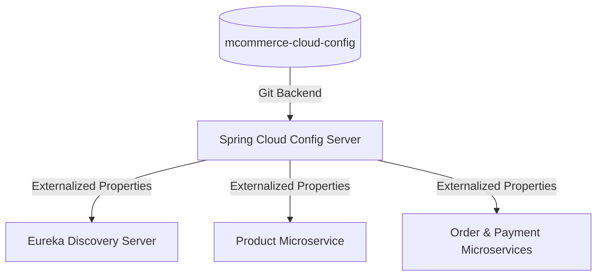

# ☁️ M-Commerce Cloud Config — Centralized Microservices Configuration

<div align="center">

[](https://spring.io/projects/spring-cloud)
[]()
[](https://spring.io)

<p align="center">
  <b>Centralized external configuration repository for distributed M-Commerce microservices.</b><br>
  Powers runtime configuration, environment profiles (dev, test, prod), and dynamic property reloads across services.
</p>

</div>

---

## 🏗️ Architecture



---

## ⚙️ Managed Configurations

| Property File | Service Name | Role |
|---|---|---|
| `eureka-server.properties` | Eureka Discovery Server | Standalone registry port, peer replication flags, and health settings |
| `microservice-produits.properties` | Product Microservice | Catalog endpoints, DB bindings, and fallback properties |

---

## 🚀 Usage in Spring Boot

In your microservice's `application.properties` / `bootstrap.properties`:

```properties
spring.application.name=microservice-produits
spring.config.import=optional:configserver:http://localhost:9101
```

---

## 👨‍💻 Author

**Omar Torbi** — Full-Stack Engineer & Software Architect
- 🌐 **Portfolio**: [omartorbi.engineer](https://www.omartorbi.engineer)
- 💼 **LinkedIn**: [linkedin.com/in/omar-torbi](https://www.linkedin.com/in/omar-torbi-b8340933a/)
- 🐙 **GitHub**: [@TORBIomar](https://github.com/TORBIomar)
- ✉️ **Email**: [torbi.dev@outlook.com](mailto:torbi.dev@outlook.com)
